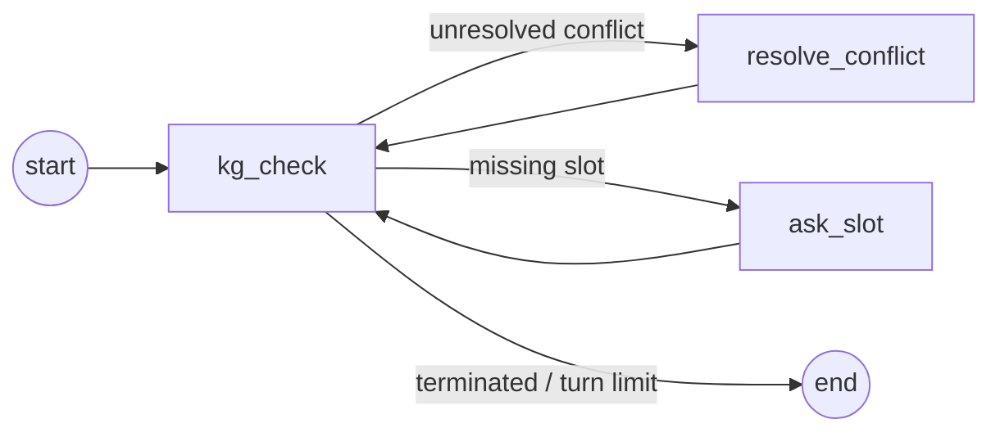

# Intent Agent — Knowledge-Guided LLM for Intent-Driven Service Orchestration


-000000)


Turn a messy, plain-English service request into a **validated, machine-ready
configuration** — without trusting the language model to get the hard decisions
right.

An LLM is great at *reading* an informal request ("we need real-time control for
60 welding robots on one factory floor, premium budget"). It is unreliable at
*deciding* whether that request is complete, self-consistent, and policy-valid.
This project keeps the LLM on language tasks and hands every decision to a small,
auditable **knowledge graph**. The payoff, measured on the original 72-sample
labeled benchmark:
**+20 points of policy validity and +35 points of contradiction detection versus
an LLM-only pipeline, while asking 3.8× fewer clarifying questions.**

It's the reference implementation behind a research paper on 6G network
orchestration, but the pattern — *LLM for understanding, symbolic layer for
decisions* — applies to any domain where an agent's output has to be correct, not
just plausible: form intake, config generation, compliance checks, structured
data extraction.

---

## Why this is worth a look

- **A hybrid architecture that actually earns its keep.** The split between LLM
  and knowledge graph isn't decorative — the ablation study quantifies exactly
  what the symbolic layer buys you (see Results).
- **Deterministic where it counts.** Completeness checks, conflict detection, and
  termination are pure-Python rules over a typed graph. The same input always
  produces the same decision, and every decision is traceable to a rule.
- **A real evaluation harness, not a demo.** 8 metrics, a 200-intent labeled
  benchmark (half of it adversarial), per-class and per-request-type breakdowns, a component ablation, and a
  "how much does knowledge coverage matter" sweep — all runnable from the CLI.
- **Runs on a single consumer GPU.** 4-bit Llama 3.1 8B served by
  [Ollama](https://ollama.com), ~6 GB VRAM. Any other Ollama model is one
  `--model` flag away.
- **Standard, inspectable orchestration.** The LLM calls are LangChain (LCEL)
  chains and the pipeline is a LangGraph state graph, so every stage and every
  clarification turn is an explicit node you can trace, swap, or visualize.

---

## How it works

The pipeline is a [LangGraph](https://github.com/langchain-ai/langgraph)
`StateGraph` (`core/pipeline/`), one node per file:

```
Natural-language request
        │
        ▼
┌─────────────────────┐
│  S1 · Classify      │   LLM — pick 1 of 4 service classes (a soft guess the
│                     │         graph can later revise or escalate)
├─────────────────────┤
│  S2 · Extract       │   LLM — pull whatever slot values the text already gives
├─────────────────────┤
│  S3 · Clarify loop  │   GRAPH — ask only for what's missing, conflicting, or
│                     │           class-ambiguous; the LLM just parses answers
├─────────────────────┤
│  S5 · Assemble      │   Build the structured profile
├─────────────────────┤
│  S6 · Deploy mode   │   GRAPH — assign TN-only / NTN-only / Hybrid from context
└─────────────────────┘
        │
        ▼
  Validated JSON profile
```

The clarification loop (S3) is its own subgraph. After every answer, a
`kg_check` node re-runs the graph's rules and routes to the next step. It also
**reopens** a conflict that is still present after a claimed fix, and **closes**
one that another change already removed:



| Does the *language* | Does the *thinking* |
|---|---|
| Classify intent, extract fields from free text, parse typed values from user answers | Which fields are mandatory, which combinations are contradictory, when to stop asking, which deployment mode fits |
| `adapters/llm/` — LangChain chains over `ChatOllama` | `core/knowledge/` (the knowledge graph) |

The LLM runs at temperature 0 with Ollama's JSON mode on for structured calls;
a tolerant parser still recovers from formatting drift. Because the **graph** —
not the model — rules on completeness and consistency, conflict detection is
deterministic, and a dialogue only terminates (Algorithm 1) when every mandatory
slot is filled and no conflict is left open.

**Conflict resolution is validated, not trusted.** The question offers only the
fields the user may change — never values the service class fixes, such as
`priority_level` — together with their allowed values. The LLM parses the
answer into a *(field, value)* choice, the value is checked against the field's
definition, and only a valid change resolves the conflict. A vague answer
("keep it as is"), a value that doesn't fit the field, or a non-change leaves
the conflict open and the question is asked again, up to the turn limit.

<details>
<summary><b>Concrete example of graph-driven conflict detection</b></summary>

> *"Sub-millisecond V2X platooning for highway trucks — and use the cheapest 5G
> plan available."*

The LLM extracts `priority=Critical` and `cost_profile=LowCost`. The graph holds
a `conflict_rule(Critical, LowCost)`, so instead of silently emitting an
impossible profile, the pipeline flags the contradiction and asks:

> *There is a conflict: Critical priority is incompatible with a LowCost profile —
> the SLA cannot be guaranteed. To resolve it, change cost_profile (Balanced,
> Premium). What would you like to change?*

Priority isn't offered, because the TimeCritical class fixes it. An answer like
"Balanced" is applied; "just keep it cheap" is not, and the question comes back.
An LLM-only pipeline, asked to self-check, misses this kind of conflict most of
the time — which is exactly what the Pure-LLM baseline below measures.

</details>

---

## Results

> **Note:** the numbers below were measured with the previous setup: the
> original 72-sample benchmark (18 per class) and its 40-sample contradictory
> subset, Llama-3-8B-Instruct via llama.cpp, and before conflict resolution was
> validated. Since then the benchmark has grown to 200 intents (see
> [Dataset & evaluation design](#dataset--evaluation-design)), the default model
> is Llama 3.1 8B on Ollama, and a conflict only counts as resolved when the
> user's change is valid. A full re-run on the new setup is in progress and will
> replace these numbers.

Full pipeline over the 72-sample labeled benchmark (18 per class),
Llama-3-8B-Instruct Q4_K_M, **zero-shot — no fine-tuning**:

| Metric | Overall | TC | MC | RC | MaC |
|---|:--:|:--:|:--:|:--:|:--:|
| Classification accuracy      | **90.3%** | 100% | 94.4% | 100% | 66.7% |
| Policy validity rate         | **95.8%** | 83.3% | 100% | 100% | 100% |
| Avg. clarification turns     | **0.57**  | 0.83 | 0.17 | 0.50 | 0.78 |
| Profile completeness         | 99.3% | | | | |
| Contradiction detection acc. | 83.3% | | | | |

**The knowledge graph vs. an LLM-only baseline** — same classifier and extractor,
but the graph's reasoning replaced by the LLM deciding completeness and conflicts
from its own knowledge (40-sample contradictory subset):

| | Policy validity | Contradiction detection | Clarifying questions |
|---|:--:|:--:|:--:|
| LLM-only            | baseline     | baseline      | baseline |
| **+ Knowledge graph** | **+20 pts** | **+35 pts**   | **3.8× fewer** |

The graph doesn't help the model *classify* better — it makes the downstream
decisions **reliable and cheap**. That's the whole thesis, and it's measured, not
asserted.

Reproduce: `intent-agent bench eval` and `intent-agent bench pure-llm --contradictory-only`.

---

## Tech stack

| | |
|---|---|
| **Language** | Python 3.10+ (dataclasses for the domain model) |
| **Inference** | [Ollama](https://ollama.com) serving Llama 3.1 8B locally by default (paper: Llama-3-8B-Instruct, Q4_K_M), via [`langchain-ollama`](https://pypi.org/project/langchain-ollama/) |
| **Terminal UI** | [`rich`](https://github.com/Textualize/rich) + [`prompt_toolkit`](https://github.com/prompt-toolkit/python-prompt-toolkit) |
| **Orchestration** | [LangChain](https://python.langchain.com) (LCEL prompt → model → parser chains) and [LangGraph](https://github.com/langchain-ai/langgraph) (pipeline + clarification-loop state graphs) |
| **Knowledge layer** | Hand-authored typed graph — required/conditional slots, conflict rules, class escalation, deployment-mode recommendations |
| **Evaluation** | Custom harness: 8 metrics, LLM-simulated user for multi-turn dialogue, ablation + coverage-sweep runners |

---

## Quickstart

```bash
python -m venv .venv && source .venv/bin/activate   # Windows: .venv\Scripts\activate
pip install -e ".[dev]"                             # installs the `intent-agent` command

# Install Ollama (https://ollama.com/download), then pull the default model:
ollama pull llama3.1:8b
intent-agent                                        # opens the interactive shell
```

The default model is `llama3.1:8b`. The paper's numbers were produced with
Llama-3-8B-Instruct (4-bit); to reproduce them, pull it and pass
`--model llama3:8b-instruct-q4_K_M`. Global options: `--model <ollama tag>`,
`--ollama-url`, `--results-dir` (env: `OLLAMA_MODEL`, `OLLAMA_HOST`,
`INTENT_AGENT_RESULTS`). `python -m cli` works too.

**Interactive shell** — `intent-agent` opens a chat-style terminal app. Type a
service request in plain English; the agent streams each stage (class, extracted
parameters, conflicts), asks you only what's missing, and renders the final
profile. Type `/` for commands, with autocomplete:

```
› Mission-critical police dispatch on a shared slice, terrestrial only
● Service class  MissionCritical
● Understood 9 parameter(s) from the text, 1 implied by the class
╭─ ⚠ Conflict ─────────────────────────────────────────────────────────╮
│ TN-only shared slice cannot guarantee 99.999% availability …         │
╰──────────────────────────────────────────────────────────────────────╯
  › add satellite fallback
● Clarified in 1 question(s), 1 conflict(s) resolved
╭─ Service profile · MissionCritical ──────────────────────────────────╮
│ …                                                                    │
```

| Command | |
|---|---|
| `/run CF-43 …` · `/random 3 adversarial` | replay benchmark intents with the simulated user, checked against labels |
| `/samples RC contradictory` · `/show <ID>` | browse the 200-intent benchmark |
| `/scenario "<persona>"` · `/scenario off` | let the LLM answer your intent's questions as a given user |
| `/model [tag]` | list or switch Ollama models |
| `/verbose` · `/json` · `/export [file]` | stage trace, raw JSON output, save the last profile |
| `/check` · `/selftest` · `/bench <exp>` · `/graph` | setup check, offline test, experiments, LangGraph diagrams |

`/cancel` stops the current intent during a question; `Ctrl+D` exits.

**Scriptable commands**

```bash
intent-agent check                          # packages, knowledge graph, dataset, Ollama model
intent-agent selftest                       # offline: all 200 intents through the graph, no model needed
intent-agent samples --type ambiguous       # browse the benchmark (--show <ID> for details)
intent-agent run CF-43 SEED-TC-01           # run intents end-to-end, check output against labels
intent-agent run --random 5 --adversarial   # random adversarial spot-check
intent-agent ask "Dedicated slice for 40 welding robots, 1 ms loop"   # you answer the questions
intent-agent graph                          # LangGraph diagrams as Mermaid
```

`run` and `selftest` exit non-zero on failure, so they can be used in scripts.

**Reproduce the experiments** — results go to `results/` (git-ignored):

```bash
intent-agent bench eval                              # full 200-intent evaluation
intent-agent bench pure-llm --contradictory-only     # knowledge graph vs. LLM-only
intent-agent bench ablation                          # turn components on/off
intent-agent bench sweep --fractions 0 25 50 75 100  # does graph coverage matter?
intent-agent bench generate --class TC --type paraphrased --n 3   # grow the dataset (review labels!)
```

---

## Architecture

```
src/
├── models/        Plain dataclasses — ontology schema, dialogue state, ServiceIntent
├── core/          Domain logic. Depends only on models and on its own ports
│   ├── ports.py         LanguageModel · UserChannel · ConflictDetector interfaces
│   ├── knowledge/       The knowledge graph
│   │   ├── catalog/       Ontology data: one file per service class, paper tables, universal rules
│   │   ├── graph.py       KnowledgeGraph queries (slots, conditionals, termination, deploy mode)
│   │   ├── conflicts.py   KG / partial-KG / null conflict detectors
│   │   ├── values.py      Allowed values per slot + validation of parsed answers
│   │   └── conditions.py  Condition operators for conditional and escalation edges
│   └── pipeline/        The LangGraph pipeline
│       ├── nodes/         One node per file: classify, extract, kg_check, ask_slot, resolve_conflict, …
│       ├── graph.py       Wiring of the pipeline and the clarification loop
│       └── runner.py      IntentPipeline facade (run / stream / mermaid)
├── adapters/      Implementations of the ports
│   ├── llm/             LangChain model, Ollama factory, offline scripted model
│   │   └── prompts/       One prompt per file
│   └── users/           Simulated (LLM persona) and scripted users
├── bootstrap.py   Composition root — the only place adapters are wired into the core
├── config.py      Settings from the environment
├── eval/          Benchmark, metrics and experiments
│   ├── dataset/         200 labeled intents as JSON + loader and filters
│   ├── metrics/         M1–M8: per sample, aggregate, report tables
│   ├── harness.py       Runs a pipeline over samples
│   └── experiments/     eval · pure_llm · ablation · kg_sweep · generate
└── cli/           Command line
    ├── commands/        One file per subcommand
    └── shell/           Interactive shell: app, user channels, completer, slash commands
tests/
├── unit/          Per layer: models, core (nodes, graph, KG, detectors), adapters, eval, cli
├── integration/   End to end: real LangChain stack with a fake chat model; CLI; live Ollama
└── support/       Test doubles (a LangChain chat model that answers by prompt type)
```

Dependencies point one way: `cli`/`eval` → `bootstrap` → `adapters` → `core` →
`models`. The core never imports LangChain, Ollama or the UI — it talks to
**ports**, and the adapters implement them. That is what makes each variant a
one-line configuration rather than a fork of the pipeline:

| Want to… | Swap |
|---|---|
| use another LLM provider | a new `LanguageModel` adapter (or another LangChain chat model in the factory) |
| answer questions from a web UI | a new `UserChannel` |
| test conflict detection without the KG | `conflict_detector=NullConflictDetector()` |
| model a partial ontology | `KGConflictDetector(kg, coverage=0.5)` |
| let the LLM run the dialogue (Pure-LLM baseline) | `node_overrides={"elicit": …, "assemble": …}` |

`tests/unit/test_architecture.py` enforces these rules: it fails if a layer
imports one it shouldn't, if a node file grows a second node, or if a module
passes 400 lines.

**Run the tests**

```bash
pytest                    # 290 tests: unit + end-to-end (live Ollama tests skip if unavailable)
pytest tests/unit         # fast, no model
pytest -m ollama          # only the tests against a real Ollama server
```

---

## Dataset & evaluation design

The benchmark lives in `src/eval/dataset/data/` — one JSON file per
request type — and has **200 intents, 50 per service class, split evenly
between well-formed and adversarial requests**:

| Request type | Per class | Total | What it tests |
|---|:--:|:--:|---|
| Seed          | 15 | 60  | Realistic, complete request for one vertical |
| Paraphrased   | 10 | 40  | The same requirements, reworded (robustness to phrasing) |
| **Ambiguous** | 10 | 40  | Mandatory details missing or vague — must ask, not guess |
| **Contradictory** | 15 | 60 | Two mutually exclusive requirements — must flag and resolve |

Ambiguous and contradictory requests make up the **100 adversarial intents**.
The 60 contradictory intents cover all ten conflict rules in the graph (five
universal, five class-specific) and span all four deployment scenarios (Urban,
RuralRemote, Disaster, Maritime).

| Collection (`eval.dataset`) | Size | Purpose |
|---|:--:|---|
| `ALL_SAMPLES` | 200 | Full benchmark — `bench eval`, `bench ablation` |
| `WELL_FORMED` / `ADVERSARIAL` | 100 / 100 | Seed + paraphrased / ambiguous + contradictory |
| `CONTRADICTORY_SUBSET` | 60 | Every conflict-rule type — `bench pure-llm`, `bench sweep` |
| `NON_CONTRADICTORY` | 140 | Everything except the contradictory intents |

The loader validates the files (unique ids, known classes, conflicts only on
contradictory samples) and the test suite checks the class × type balance.

Every sample carries a ground-truth class, an expected slot subset, and (for
contradictory samples) the conflict that *should* be caught. **Labels are
hand-authored and verified against the ontology — never taken from LLM output.**
The LLM stages run zero-shot, so there's no train/test split to worry about.
Multi-turn dialogue is evaluated with an LLM standing in as the user, driven by a
per-sample scenario script.

Four service classes model the span of 6G traffic: **TimeCritical** (sub-ms
industrial control), **MissionCritical** (resilient public-safety with fallback),
**RemoteConnectivity** (satellite/rural reach), and **MassiveConnectivity**
(millions of low-power IoT devices).

---

## About

Built by **Wajdi Hammami** ([@WajdiHammami](https://github.com/WajdiHammami)),
Polytechnique Montreal, as the reference implementation for the paper *"Knowledge-
Guided LLM for Intent-Driven Service Orchestration in Integrated Terrestrial and
Non-Terrestrial 6G Networks"* (Hammami, Azam, Cherkaoui).

Released under the [MIT License](LICENSE).
